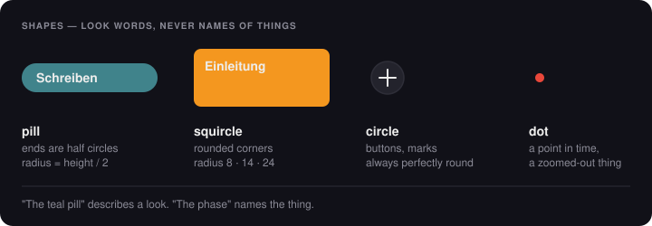
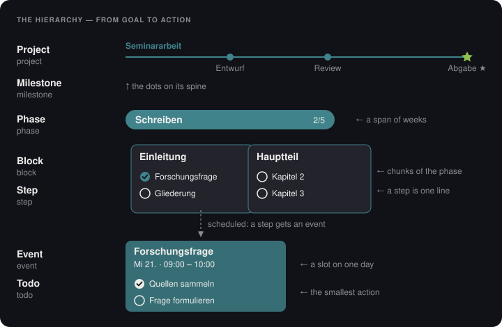
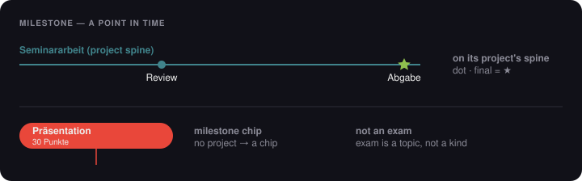
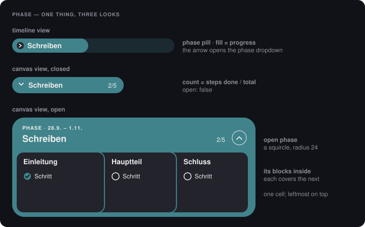
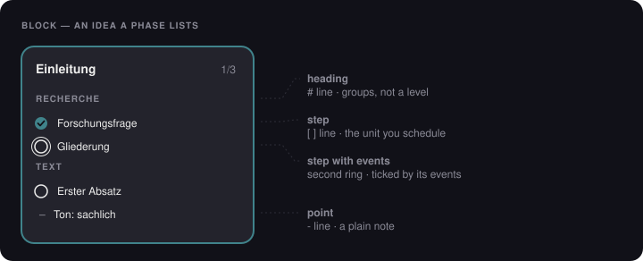
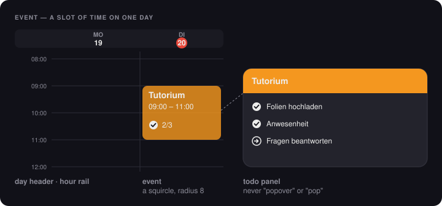
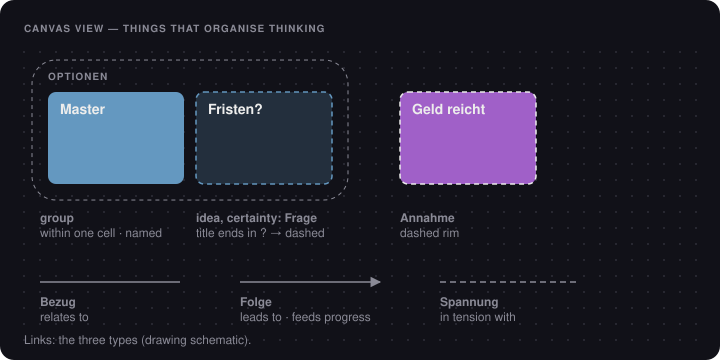
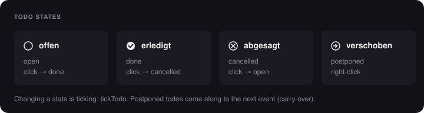
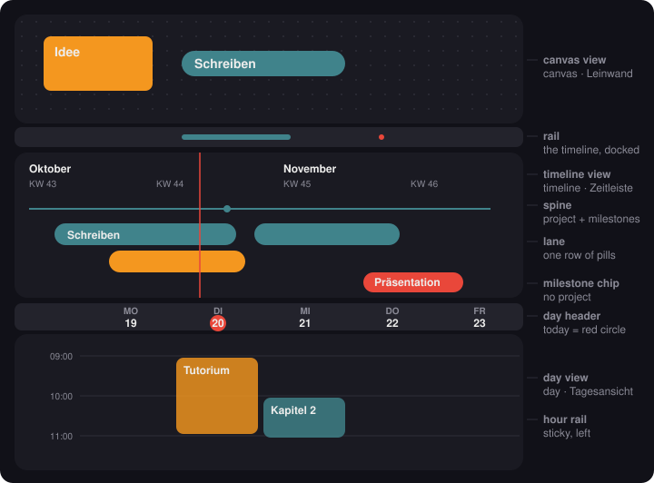
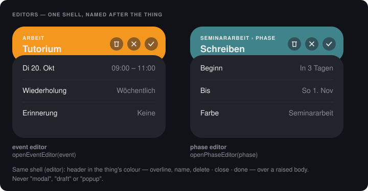

# Timeline — Rulebook

> **The dictionary and the product's rules.** Canonical since 20 Oct 2026; replaces both earlier rulebooks (the root `RULEBOOK.md` of the rejected v3 build, and `claude/RULEBOOK.md` of 2 Oct, whose decisions are all kept here).
> Lines marked **Max** are his decisions. Lines marked **Claude** are Claude's proposals, open to revision. Everything else is derived.
> **When a word, a behaviour or a design choice is unclear, this file decides. When this file is wrong, fix the file first, then the code.**
> How the code is built is in `ARCHITECTURE.md`; why things were decided is in `DECISIONS.md`.

**How to read it.**
- **Part A, the dictionary**, says what every word means. Read it before writing code, a prompt or a log.
- **Part B, the rules**, says how the things behave: progress, time, views, data.
- **"Today in the app"** notes describe the live app (`index.html`, the V2 build of June 2026, "v2_7") as of 20 Oct. They show which old words still need to go. They disappear as the restructure removes them.

---

# Part A — The dictionary

## A.1 How names are made

**The test for every name: someone who has read this dictionary can guess what it means without opening the code.** A name that needs explaining is a wrong name.

1. **One concept, one word.** Each concept has one German UI word, one English code word and one stored name, all listed below. No synonyms, no abbreviations, no jargon. ("Pop" and "popover" are web jargon for *how* a window appears; they say nothing about what it's for. They're banned.)
2. **Name the thing by what it is, never by how it looks.** A phase is a `phase`, even though it's drawn as a pill. Shape words (A.3) appear only where the look itself is meant: CSS classes, design specs.
3. **Build names, don't invent them.** A name is put together from words already in this dictionary:

   | Pattern | Made of | Examples |
   |---|---|---|
   | **thing + part** | a thing (A.4–A.6) + a part (A.8) | event editor, phase editor, todo panel, phase dropdown, project spine |
   | **verb + thing** | a verb (A.10) + a thing | `moveEvent`, `openPhaseEditor`, `tickTodo`, `renderTimeline` |
   | **thing + property** | a thing + a field | `eventStart`, `phaseCount`, `todoState` |

   If a name can't be built this way, a concept is missing. Add it here first, then use it.
4. **The same idea gets the same word everywhere.** A phase dropdown and a canvas phase both open and close, so both use `open` (never `expanded` in one place and `fold` in the other). Everything that's ticked is ticked with `tick`. Ideas repeat; their names repeat with them.
5. **When a role comes from a relation, the role gets its own word.** An idea listed by a phase is a *block*. The kind stays `idea`; the phase's list is `blocks`.
6. **When two words compete, keep the one the user sees and says.** The UI says "Termin bearbeiten", so the code says `eventEditor`.
7. **Stored names are forever; code names are cheap.** Stored data is renamed once, with a migration that copies. Code names are renamed whenever that code is touched anyway.
8. **Spelling by place:**

   | Place | Style | Example |
   |---|---|---|
   | JavaScript | camelCase | `startMin`, `openEventEditor` |
   | Database columns | snake_case | `start_min`, `deleted_at` |
   | CSS classes | kebab-case | `.todo-panel`, `.pill` |
   | Constants, tunables | UPPER_SNAKE | `PAN_ZONE` |
   | UI text | German, Austrian | Jänner, KW |

## A.2 Reading an entry

> **Concept** · *DE (UI word)* · `code` · stored as `field`
> What it is. **Not:** what it's easily confused with. **Never say:** banned words, listed in A.11 and checked by the vocabulary test.
> *Today in the app:* how the live app (`index.html`, "v2_7") still does it, until the restructure removes it.

Pictures live in `docs/dictionary/`. They are drawn in the app's own colours, so what you see is what the word means.

---

## A.3 Shapes — the look words



| Shape | What it looks like | Used for |
|---|---|---|
| **pill** | a rounded bar whose ends are half circles (radius = height / 2, always) | phases, dated ideas on the timeline, chips, the closed phase on the canvas |
| **squircle** | a rectangle with rounded corners (radius 8 for small, 14 for panels, 24 for an open phase) | ideas and blocks on the canvas, events in the day view, editors, panels |
| **circle** | a perfect circle | buttons, todo marks, a milestone on the canvas |
| **dot** | a small filled circle | a milestone on its spine, a time dot, a zoomed-out item |

A shape word never names a thing. "The teal pill" describes a look; "the phase" names the thing. **Never say:** card, bar, box, field, tile, balken (as a name for a thing).

---

## A.4 The hierarchy — from goal to action



**Project** · *Projekt* · `project` · stored as a `category` with `start`/`end`
An ongoing workload with a start and a final deadline: a category that has a span. Drawn as a **spine** in the timeline view, carrying its milestones, with its phases in lanes below. **Not:** a group on the canvas (a group *may* become a project later; **Max**, 30 Sept). **Never say:** track.
In the app: a `categories` record with `start`/`end` (end exclusive). Its milestones are those whose `categoryId` is the project's.

**Milestone** · *Meilenstein* · `milestone` · item `kind: 'milestone'`

A distinct point in time: a deadline, an exam, a hand-in, a birthday. Not above or below a phase — different. With a project's colour it's a dot on that project's spine; otherwise a chip. A project's closing milestone is `final` (★). **Not:** an event (no hours) or a phase (no span). **Never say:** exam, point (for the item), goalpost.
In the app: `milestones` records `{ title, date, categoryId, final, note }`. Exams and project milestones became this one list on 21 Oct (**Max**, 30 Sept); an exam's points became its `note`. A chip without a category is drawn red, as exams were, until colour and category are aligned (B.8).

**Phase** · *Phase* · `phase` · item `kind: 'phase'`

A span of weeks or months. Drawn as a pill on the timeline view; on the canvas a closed phase is a pill and an open phase is a squircle holding its blocks. **Not:** every pill on the timeline — a dated idea is a pill too, and stays an idea. **Never say:** bar, balken, pill, track (as the thing's name).
In the app: `phases` records; end exclusive since 21 Oct. *Today in the app:* the description is still HTML in `details` (becomes `body` with the canvas).

**Block** · *Arbeitsblock* · `block` (a role) · an idea listed in a phase's `blocks`

A chunk of a phase, sized to sit down and work through. An idea is a block *because* a phase lists it; pulled out, it's an idea again. **Not:** an event — blocks aren't on a day (**Max**, 29 Sept). **Never say:** kids, chapter, work package, card.
*Today in the app:* doesn't exist yet; returns with the canvas view.

**Step** · *Schritt* · `step` · the n-th checkbox line of a body ↔ `steps[n]` (a permanent id)
One concrete thing to get done inside a block, and the unit you schedule: dragged into the day view, it gets an event. It can be scheduled more than once. **Not:** a todo (todos live in events, **Max**, 29 Sept). **Never say:** task, Aufgabe.
*Today in the app:* doesn't exist yet; returns with the canvas view.

**Event** · *Termin* · `event` · `events` row

A slot of time on one day, with a start and end time, a category and its own todos. Drawn as a squircle in the day view. It may point at a step; without one it's an ordinary calendar entry (dentist, lunch). **Not:** a milestone (no hours) or a block. **Never say:** session, daily item, appointment, card, termin (in code).
In the app: `events` records, drawn by `renderEvent` with class `.event`.

**Todo** · *Todo* · `todo` · an entry in one day's list of an event: `todosByDate[day]`
The smallest action. Lives in **one occurrence** of an event, never in a whole series (**Max**, 21 Oct): a weekly crit's todos for this week are not next week's. A repeating event's later occurrences start empty. Has a state (A.7). Read with `todosOf(event, day)`, written with `setTodosOf` (`core/todos.js`). **Not:** a step. **Never say:** subtask, task, check item.

---

## A.5 Things that organise thinking (outside the hierarchy)

None of these counts toward progress.



**Idea** · *Idee* · `idea` · item `kind: 'idea'`
The free thing you draw and type into on the canvas, drawn as a squircle. Untimed unless given a date. When a phase lists it, it becomes a block. **Never say:** card, field, Fläche, note, shape.

**Group** · *Gruppe* · `group` · `groups` row
Ideas within one cell of each other. Emerges; becomes fixed only when named. Named groups never fuse. An open phase counts with its whole squircle. **Never say:** cluster.

**Category** · *Kategorie* · `category` · `categories` row, keyed by colour id
One of eight colour slots that has a name. **Colour = category, everywhere** (**Max**, provisional, 30 Sept): an idea coloured teal belongs to whatever teal is named. Each colour belongs to at most one category or project. Grey is **frei** and never a category. **Never say:** track, tag, label (for a category).
*Today in the app:* keyed by a word id (`"seminar"`) whose record holds the hex; things point to it by `categoryId`. The new store keys by colour id.

**Colour** · *Farbe* · `colour` · colour id: `amber red teal blue green gray purple pink`
The slot itself, named or not. Its lighter version is its **wash** (B.3). In stored data the field is `cat`. **Never say:** orange (for `#d86e9a`; it's `pink`).

**Heading** · *Überschrift* · a body line starting `# `
A visual divider inside an idea or block. Groups and counts the lines below it. **Not a level** (**Max**). **Never say:** section, chapter.

**Point** · *Punkt* · a body line starting `- `
A plain note line. Not a step. "Punkt" means only this in the UI. **Never say:** bullet.

**Link** · *Verbindung* · `link` · `links` row, `type` absent / `seq` / `con`
A line between two things: **Bezug** (relates to; no type stored), **Folge** (leads to; feeds a milestone's progress), **Spannung** (in tension with). **Never say:** connection, connector, edge.

**Certainty** · *Stand* · `certainty` · `question` / `assumption` / absent
How settled an idea is: **Frage** (a title ending in `?`, dashed outline), **Annahme** (dashed rim), **Geklärt** (solid; nothing stored). A milestone adds **Erreicht** (`reached`). **Never say:** state, status (`state` belongs to todos).

**Table** · *Tabelle* · `table` · item `kind: 'table'`
A grid with formulas. A table comparing a group row by row is a **decision** (*Entscheidung*): the chosen row stays, the rivals fade.

**Pile** · *Stapel* · `pile` · item `kind: 'pile'`
Photos stacked as one item. **Never say:** album.

---

## A.6 Time

**Date** · *Datum* · `date` · ISO day string `2026-10-20`
A day, without a time.

**Start / end** · *Beginn / Ende* · `start`, `end`
A span's first day, and the day **after** its last day. **Stored ends are always exclusive.** Every field that shows an end shows the **last day** (*bis*). **Never say:** `to`, `until`, `endDate` for the exclusive value.
Code: `lastDay(end)` gives the shown last day, `dayAfter(day)` the stored end (`core/dates.js`).

**Minutes** · — · `startMin`, `endMin`
An event's times, as minutes since local midnight (540 = 09:00).

**Time dot** · *Eckpunkt* · `timeDot`
The dot on a thing's edge, dragged onto the timeline to give it a date. **Never say:** handle, point.

**Repeat** · *Wiederholung* · `repeat` · `none` *Keine* · `daily` *Täglich* · `weekly` *Wöchentlich* · `monthly` *Monatlich* · `weekdays` *Werktags*
A rule that makes one event occur on many days. Each day it appears is an **occurrence** (`occurrence`).

**Reminder** · *Erinnerung* · `reminderMin`
Minutes before an event's start when a notification fires. **Never say:** alarm.

**Carry-over** · *Übernahme* · `carryOver`
Postponed todos come along to the next time (**Max**, 21 Oct):
- **a new event** takes the postponed todos of the latest event of its category (or, later, of its step);
- **the next occurrence of a series** shows the postponed todos of the occurrence before it. They are only shown until something changes in that occurrence, then stored there. One step only: a todo carried into next week isn't carried further unless postponed again.
A todo that came along has `carried: true` and shows ↻. The original stays postponed where it was. **Never say:** inherit.

**Today** · *Heute* · `today` — the current day; the today line is red.

**Calendar week** · *KW* · `isoWeek` — ISO week number, shown as "KW 43".

## A.7 Todo states



| State | DE | `state` | Mark | How you get there |
|---|---|---|---|---|
| open | offen | `open` | ○ | click cycles open → done → cancelled → open |
| done | erledigt | `done` | ✓ | |
| cancelled | abgesagt | `cancelled` | ✕ | |
| postponed | verschoben | `postponed` | → | right-click toggles; postponed todos carry over |

Changing a todo's state is **ticking** it (`tickTodo`). **Never say:** completed, closed, deferred, skipped.

---

## A.8 Views and their parts



**View** · *Ansicht* · `view`
One of the levels stacked on the one page, reached by scrolling down. **Never say:** level (that's the hierarchy's word), page, screen, frame.

**Canvas view** · *Leinwand* · `canvas` — the free, endless dot grid at the top. Ideas, phases, groups, links. **Never say:** board, whiteboard, notes.

**Timeline view** · *Zeitleiste* · `timeline` — months and weeks across, endless sideways. Projects, phases, milestones. Its collapsed strip under the canvas is the **rail** (`rail`), still the Zeitleiste, just docked.

**Day view** · *Tagesansicht* · `day` — the hour grid with 3, 5 or 7 day columns (the **density**, `density`). Events and their todos. **Never say:** daily view, calendar view, week view.

**Single day view** — one day at a time. Not designed; no name until it is.

### Parts

A part is always named **thing + part**. These are all the part words:

| Part | What it is | Examples |
|---|---|---|
| **editor** | the one squircle sheet for editing a thing, in the thing's colour | event editor, phase editor, milestone editor, idea editor, project editor |
| **panel** | a small squircle attached to a thing, for a quick action | todo panel |
| **dropdown** | what unfolds below a pill when ▸ is tapped | phase dropdown |
| **label** | a thing's name drawn on or beside it; sticky labels pin to the left edge | phase label, month label |
| **mark** | anything the rail or timeline view draws for a thing | the phase's mark, a milestone's mark |
| **spine** | a project's thin line on the timeline view | project spine |
| **lane** | one row of the timeline view where marks sit without overlapping; computed, never stored | |
| **chip** | the pill of a milestone that belongs to no project | milestone chip |
| **header** | the strip at the top of a view or editor | day header (weekdays), app header, editor header |
| **hour rail** | the sticky column of hours at the left of the day view (68px) | |
| **count** | done/total, as "3/5" | phase count |
| **fill** | the coloured share of a pill or ring that shows progress | phase fill |
| **overlap** | events in one day column whose times overlap, drawn side by side | |
| **window** | a squircle shown centred over a dimmed backdrop (the **overlay**); code: `.overlay-window` | the editor, the time budget |



**Editor** · *(thing) bearbeiten* · `editor`
All editors share one shell (**Max**, 2 Oct): a header in the thing's colour (overline, name, delete · close · done) over a raised body. Each is called after its thing: the event editor is `openEventEditor(event)`; the shared shell is `editor`. **Never say:** modal, dialog, draft, popup, sheet.
The editor is a window (see Parts). Code: `openEditor(ctx)`, `UI.editor`, IDs `#editor…`. *(Renamed from `openModal`/`mcard` on 21 Oct.)*
**Closing** (**Max**, 21 Oct): a tap outside the editor **saves**, because it is usually an accident and the input shouldn't be lost. ✕ and Escape cancel. Changing one field never resets another.

**Todo panel** · — · `todoPanel`
The small panel on an event for ticking and adding todos. **Never say:** popover, pop, popup.
Code: `openTodoPanel`, `UI.todoPanel`, ID `#todoPanel`, classes `.panel-…`. *(Renamed from `openTodoPop`/`#pop` on 21 Oct.)*

**Settings** · *Einstellungen* · `settings` — the drawer for colours, projects, data, display and reminders. Changes apply at once.

**Add mode** · *Hinzufügen* · `addMode` — the + button's mode: the next drag creates something, then the mode ends by itself.

**Time budget** · *Zeitbudget* · `timeBudget` — the chart of time actually spent per category over 7 or 30 days, from events.

**Zoom level** · — · `zoomLevel` `A` `B` `C` `D` — what the canvas view shows at a zoom (B.5).

## A.9 Code-only words

**Item** · `item` — the one stored record for anything on the canvas or timeline view. Its `kind` is `idea`, `phase`, `milestone`, `table` or `pile`. **Never say:** card, node, element (for an item).
**Kind** · `kind` — what an item is. **Never say:** type (`type` is for links and the editor's context).
**Initial values** · `initial` — the starting values of a thing being created in the editor; the counterpart of `edit`, the existing thing being edited. **Never say:** draft.
**Body** · `body` — the text of an idea, block or phase: steps (`[ ]`), headings (`#`), points (`-`), plain lines. Written only through `setBody`. **Never say:** details, description, content.
**Store** · `store` — the one holder of state (ARCHITECTURE §4).
**Record** · `record` — one stored thing that syncs on its own: a category, a phase, a milestone or an event.
**Stamp** · `updatedAt` — when a record last changed; set only by the gate.
**Deleted** · `deleted` — records removed from the plan: id → the list it was in and when. Keeps a deleted record from coming back.
**Login** · *Anmeldung* · `login` — who is signed in on this device: email, and the tokens that let it sync. Lives on the device. **Never say:** session (that word is banned: it was once used for events).
**Sync** · *Sync* · `sync` — bringing this device and the server in step: pull, merge, push (ARCHITECTURE §5). A record's server copy is a **row**.
**Device state** · `device` — what belongs to this screen, not the plan: theme, number of days, open dropdowns. Saved per device, never synced, not undoable.
**The gate** · `mutate(fn)` — the one way to change the plan; stamps what changed (ARCHITECTURE §4).
**Progress** · `progress` — a number from 0 to 1, shown as a fill or a count.
**Open** · `open` — whether something that unfolds is unfolded: a phase on the canvas, a phase dropdown. **Never say:** expanded, fold, collapsed.

## A.10 Verbs

One verb per action, everywhere:

| Verb | Means | Never |
|---|---|---|
| `create` | make a new thing | add, new, make (in code) |
| `delete` | remove a thing | remove, destroy, drop |
| `move` | change where or when a thing is | shift, drag (drag is the gesture, not the action) |
| `resize` | change a span's length | stretch |
| `open` / `close` | show / hide an editor, panel or dropdown | expand, collapse, toggle, show, hide |
| `tick` | change a todo's or step's state | check, toggle, cycle |
| `schedule` | give a step an event | plan, assign |
| `render` | draw a view or part from state; never changes state | draw, paint, build |

## A.11 Never say — the list the test reads

The vocabulary test (`tests/vocabulary.test.mjs`) reads the block below: `banned word → the word to use`. It splits camelCase and kebab-case, so `examRow` and `.ev-card` both match. **No mono font, ever** (**Max**): numbers that change while you watch use DM Sans with tabular figures. JavaScript's `.pop()` is never counted. Exempt whole words: `scrollbar`, `zoomLevel`.

```never-say
session → event
dailyitem → event
appointment → event
subtask → todo
task → step
aufgabe → schritt
exam → milestone
prüfung → meilenstein
goalpost → milestone
track → category (a colour slot) / follow (a pointer)
kids → blocks
cluster → group (canvas) / overlap (day view)
album → pile
connector → link
card → idea / event / panel / overlay-window
evcard → event
mcard → editor
bar → pill (the shape) / header (a strip)
topbar → header
balken → pill
fläche → idee
popover → todoPanel
pop → todoPanel (JavaScript's own list method .pop() is exempt)
popup → editor / panel
modal → editor
draft → editor (the window) / initial (a new thing's starting values)
details → body / dropdown
bubble → dropdown
expanded → open
fold → open
level → view
mono → DM Sans with tabular figures (font-variant-numeric: tabular-nums)
monospace → DM Sans with tabular figures
```

---

# Part B — The rules

## B.1 Principles

1. **Hierarchy first.** Every piece of planning belongs somewhere between a goal and a thing you do today. The tool's main job is to keep that link visible. *(Max)*
2. **Concrete in time, second.** Planning becomes real when it gets a date. Every level can be placed in time; none has to be. *(Max)*
3. **What is not when.** The hierarchy says *what* (project → phase → block → step). The calendar says *when* (an event on a day). An event can point at a step; neither is the other.
4. **One rule for progress.** A parent's progress is the equal-weight average of its children. The same rule at every level. *(Max, by example: a phase with one done block is 100 %; add a block and it's 50 %.)*
5. **Role comes from relation.** An idea is a block *because* a phase lists it. Nothing is stored twice.
6. **Planning above, execution below.** Canvas and timeline are for planning; the day view is for doing. A feature that blurs this line needs a strong reason.
7. **Structure emerges.** Nothing asks for structure before there's thinking to structure.

## B.2 The hierarchy

| Level | Contains | Done when | Lives in |
|---|---|---|---|
| Project | phases, milestones (by colour) | all phases done and milestones reached | settings (name, span) + timeline |
| Milestone | nothing | ticked "Erreicht" by hand; until then its ring shows the chain leading to it | canvas + timeline |
| Phase | blocks | every block is done | canvas + timeline |
| Block | steps | every step is done | canvas (listed in the phase dropdown) |
| Step | events | every event of it is done; with none, ticked by hand | canvas; dragged from the timeline into the day |
| Event | todos | every todo is done (cancelled ones don't count); with no todos, ticked by hand | day view |
| Todo | — | ticked | day view |

**Max:** a block's checkbox lines are its steps; they are what later appear in the timeline and get dragged into the day. *(29 Sept)*
**Max:** todos live in events, not on the canvas. *(29 Sept)*
**Max:** a step can be scheduled more than once. It's then no longer done until the new event is. *(29 Sept)*
**Max:** a project is a category with a span. A named canvas group *may* later become a project — a possibility, not a necessity. *(30 Sept)*
**Max:** exams are milestones. *(30 Sept)*

**Derived rules.**
- A step with events can't be ticked by hand; its tick shows its events. A step with none is ticked directly.
- Every event weighs the same, whatever its length. So does every block and every step. *(Revisit if it feels wrong in use.)*
- A checkbox line is a step wherever it sits. On a free idea it's still a step; the idea becomes a block when a phase takes it.
- A phase without blocks may carry steps itself; it then counts as its own single block.
- An event without a step touches no hierarchy.
- A phase shows its steps as its count (done/total over its blocks); its fill still weighs every block the same. **Claude** *(2 Oct)*

### B.2.1 Phase and block geometry — **Max** *(2 Oct: "take the geometry, not only the colour")*

- Containment and sequence are shown by overlap, not by boxes or tints.
- Open horizontal phase = a squircle: radius 24, its colour, a 68px header (overline "PHASE · dates", name, step count, collapse button), its blocks inside at 8px inset.
- Blocks are 224×192 (7×6 cells); they may grow taller, never narrower. Each covers the first cell (32px) of the next; the leftmost is on top, with a 2px seam in the phase's colour. An open block is raised; a done block wears the phase's colour as its top 44px.
- The open phase is at least as wide as its header, and its footprint ends on the next full cell. **Claude**
- Vertical phases keep the older tray.

## B.3 Colour and category

- **Colour = category, everywhere** (**Max**, provisional). Named, a slot is a category; named with a span, a project. Grey is frei. *How category, project and colour align with the philosophy is to be figured out later.*
- The eight colours, in order: `amber` #f4971f · `red` #e9473a · `teal` #40838b · `blue` #6498c0 · `green` #8fc14e · `gray` #90909a · `purple` #a060c8 · `pink` #d86e9a.
- Recolouring a project or category moves its things with it. *(Max, 2 Oct)*
- The canvas colour picker shows the category names, so the choice is informed. *(follow-up)*
- **Solid colours only.** A colour's lighter version is its **wash**: the hex at 0x38, pre-blended on the base, defined once in `styles/tokens.css`. Text on a colour is always #ededec.

## B.4 Time

- **The day is the unit everywhere.** On the canvas and the rail, 1 grid cell = 1 day at 100 %. *(Max)*
- An item's place on the canvas is not its date; its mark on the timeline is.
- The timeline shows exactly what the rail shows: the same rule, not a copy of the marks. **Claude**
- A dated block is drawn inside its phase's pill.
- **Stored ends are exclusive** (A.5).
- Defaults when placed in time: a phase gets 14 days; a milestone, a block or a step 1 day; an event from a step 1 hour.
- Relative wording in editors and settings: Heute · Morgen · In n Tagen · Noch n Tage · Vor n Tagen.

## B.5 Zoom (canvas)

10–100 %, continuous; what is shown changes at four levels (thresholds are proposals, to tune by eye):
- **A, ≥ 80 %:** everything.
- **B, 45–80 %:** blocks keep their geometry and show their name and steps as dots; ideas show only their name.
- **C, 20–45 %:** no blocks. Every horizontal phase is a pill (wash, colour up to the done fraction, name, count). Ideas are coloured shapes.
- **D, < 20 %:** each group is one squircle with a segmented pill, one segment per phase. Everything else is a dot. A tap zooms in.
- Nothing moves between levels. At C and D no text is smaller than 11px on screen.

## B.6 Views

- One page, stacked: canvas → timeline → day view → (single day). **Max**, 20 Oct.
- Scrolling moves between views; zoom changes scale. They are never the same gesture.
- **One editor everywhere** (**Max**, 2 Oct): a header in the item's colour (overline, name, delete | close | done) over a raised body. The overline says where the item sits; a block's overline is a breadcrumb to its phase. On the canvas the editor sits beside the focused item (never over it when there's room) and edits live, so close and ✓ both just close it. **Claude** *(2 Oct)*

### Scheduling a step *(built in the step-D build; returns after the restructure)*
1. The phase dropdown shows the phase as the canvas has it: its own lines, then each block with its lines.
2. Every step has a dot. Dragging it into the day view creates an event for that step: titled by it, one hour, in the block's colour. Its todo panel opens. Dropped anywhere else, nothing happens.
3. Todos typed into the event belong to the event.
4. Ticking todos rolls up: event → step → block → phase → milestone ring.
5. Dragging the same step in again adds a second event; the step is open again until both are done.
6. A step with events shows a second ring. On the canvas a tap on it says why it can't be ticked; in the timeline a tap goes to its next event.
7. Names follow both ways: renaming the step renames its events, and the reverse (same step id). **Claude**

## B.7 Data

The gate, the store and sync are defined in `ARCHITECTURE.md` §4–5. The rules that belong to the product:

- **One record per thing.** Everything on the canvas and the timeline is an item; the timeline shows items, it doesn't own copies.
- **A phase's `blocks` is the only truth** about which ideas are its blocks. An idea stores nothing about its phase.
- **Step ids survive edits.** Every write to a body goes through `setBody`. Ids are unique everywhere.
- **Deleting a phase or milestone** deletes it everywhere; its blocks become free ideas and its links go with it. Undoing restores it whole. Deleting a dated idea or block *in the timeline* only removes its date. **Claude**
- **Something made in the timeline** gets a place on the canvas: a row under everything there, two cells clear, on the lattice. **Claude**
- **Deleting a category** only removes the name from its colour; its items keep their colour.
- **Device state is never synced:** canvas camera, scroll position, which dropdowns are open.

## B.8 Open questions

- **Colour, category, project** — how they should align with the philosophy. *(Max)*
- **Group as project** — possible later, not needed now. *(Max)*
- **Event length vs. weight** — equal weight for now.
- **Where steps are stored** (in the body, or rows of their own) — decided when the canvas returns. *(ARCHITECTURE §8)*
- **A deeper level** below todo — deferred. Todo stays the smallest action. *(Max)*
- **Single day view** — not designed; no name yet.
- **The rest of the design spec** (§1 global rules outside the reworked sections, §3–5, §8.1–8.3, §8.5–8.6, §8.9) — not yet done. **Claude**
- **Contrast** — white text on amber, green, blue, pink and grey fills is below 4.5:1. *(Max to decide later)*
- **Deleting one occurrence** of a repeating event — today, deleting deletes the whole series ("Serie gelöscht"). Calendars usually ask "this one or all". **Claude** *(noted 21 Oct)*
